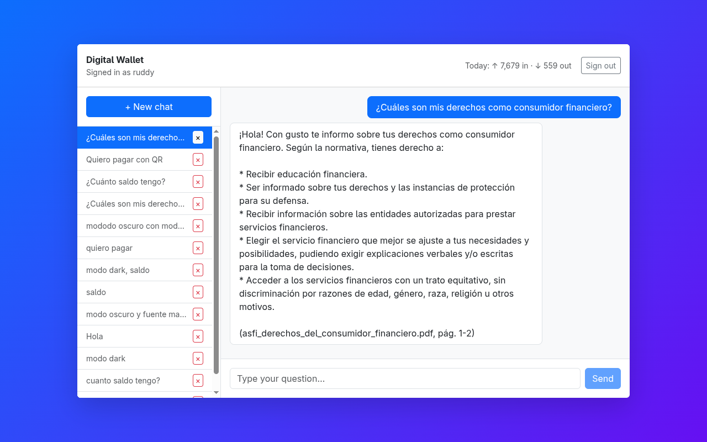
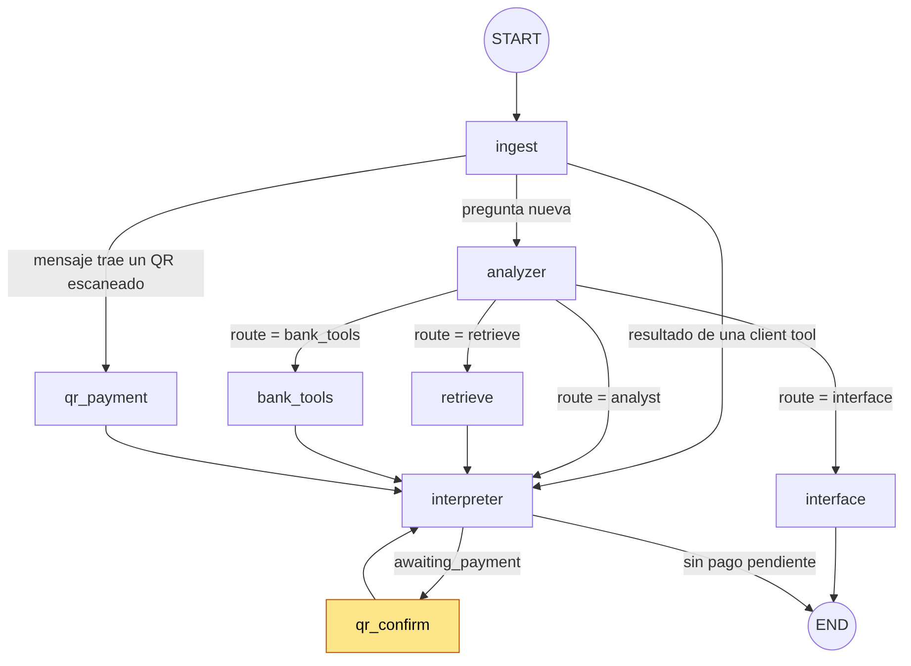

# Bank Assistant AG-UI

Billetera digital con un asistente de IA: el cliente conversa para consultar su saldo, resolver dudas sobre tarifas y normativa (RAG con fuentes citadas) y pagar con QR, con confirmación antes de cada pago.

- **Backend:** Python, FastAPI y LangGraph (Gemini como LLM, Chroma como base vectorial).
- **Frontend:** React + Vite, conectado al agente por el protocolo [AG-UI](https://docs.ag-ui.com).



**Demo en móvil:** [docs/video/demo-movil.mp4](docs/video/demo-movil.mp4) · **Propuesta:** [docs/propuesta.md](docs/propuesta.md) ([Word](docs/propuesta.docx))

## Qué puede hacer

- Responder dudas con RAG sobre 6 PDFs públicos (tarifarios de BancoEconómico y normativa ASFI), citando documento y página.
- Mostrar el saldo en una tarjeta.
- Pagar con QR: el frontend escanea el código y el grafo se pausa (`interrupt()`) hasta que el usuario confirma.
- Cambiar fondo, modo claro/oscuro y tamaño de letra con herramientas del frontend.
- Medir el consumo de tokens por usuario y por día.

## Estructura

| Carpeta | Contenido |
|---|---|
| [`digital-wallet-rqm/`](digital-wallet-rqm/README.md) | Backend: API, agente LangGraph, RAG. Arquitectura hexagonal ([detalle](digital-wallet-rqm/docs/architecture.md)) |
| `digital-wallet-rqm-web/` | Frontend React |
| `docs/` | Propuesta, diagramas, capturas y video |



## Cómo ejecutarlo

Requisitos: Python 3.13+ con [uv](https://docs.astral.sh/uv/), Node 22 y una API key de Gemini.

**1. Backend** (`http://127.0.0.1:8000`, docs en `/scalar`)

```bash
cd digital-wallet-rqm
cp .env.example .env   # completa las variables de abajo
uv sync
uv run python scripts/download_bank_documents.py   # descarga los PDFs a data/documents
uv run fastapi dev src/digital_wallet_rqm/main.py
```

Variables de `.env`:

| Variable | Uso |
|---|---|
| `GOOGLE_API_KEY` | API key de Gemini |
| `GEMINI_CHAT_MODEL` | Modelo de chat |
| `GEMINI_EMBEDDING_MODEL` | Modelo de embeddings (ej. `gemini-embedding-2`) |
| `JWT_SECRET` | Secreto para firmar los tokens |
| `FRONTEND_ORIGINS` | Orígenes CORS (por defecto `http://localhost:5173`) |

**2. Indexar los documentos** (una sola vez; las siguientes solo procesan lo que cambió)

```bash
TOKEN=$(curl -s -X POST localhost:8000/auth/token -H 'Content-Type: application/json' -d '{"nickname":"ruddy"}' | jq -r .access_token)
curl -X POST localhost:8000/admin/index -H "Authorization: Bearer $TOKEN"
```

Con el free tier de Gemini (100 embeddings por minuto) se indexa en lotes de 90 con pausas de 60 s, así que la primera vez tarda unos minutos.

**3. Frontend** (`http://localhost:5173`)

```bash
cd digital-wallet-rqm-web
npm install
npm run dev
```

Si el backend no está en `http://localhost:8000`, define `VITE_API_URL` en un `.env`.

## Tests

```bash
cd digital-wallet-rqm && uv run pytest
cd digital-wallet-rqm-web && npm test && npm run lint
```

## Licencia

MIT, ver [LICENSE](LICENSE).
