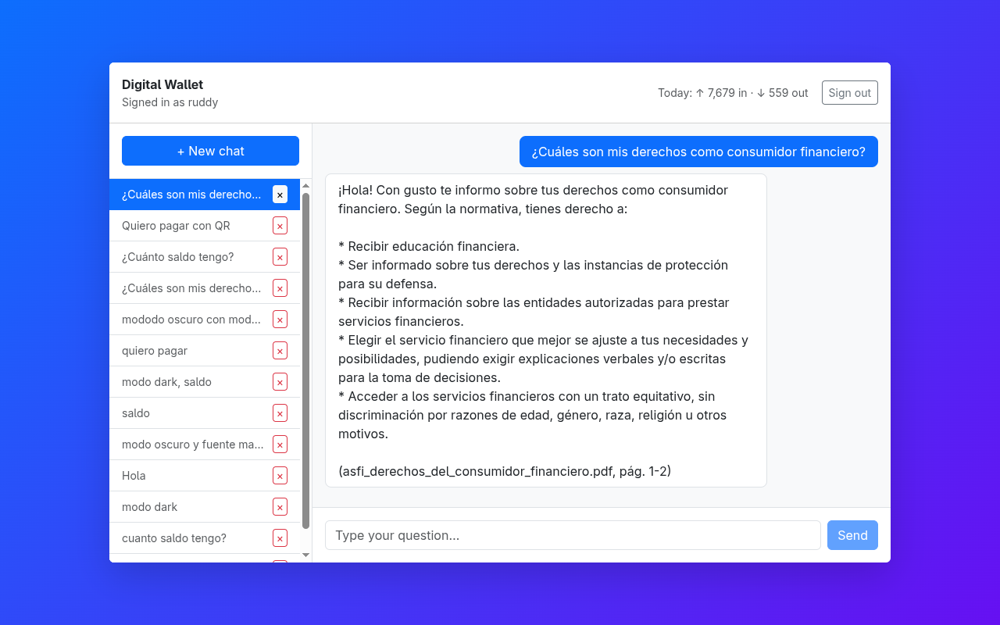
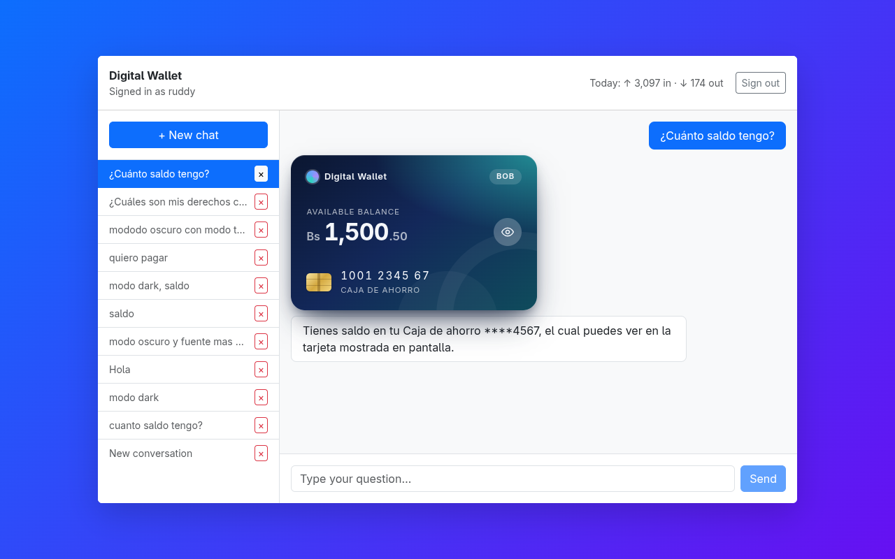
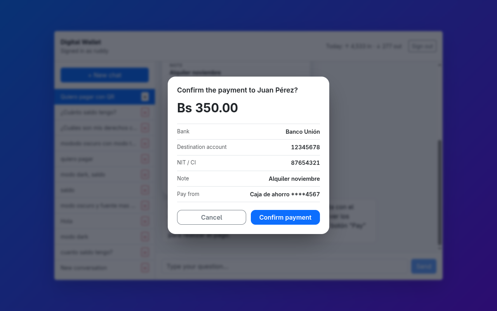
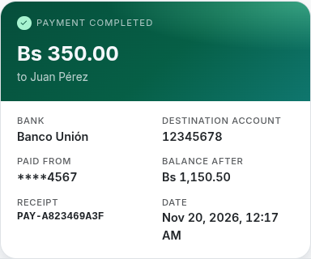
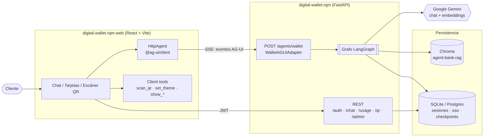
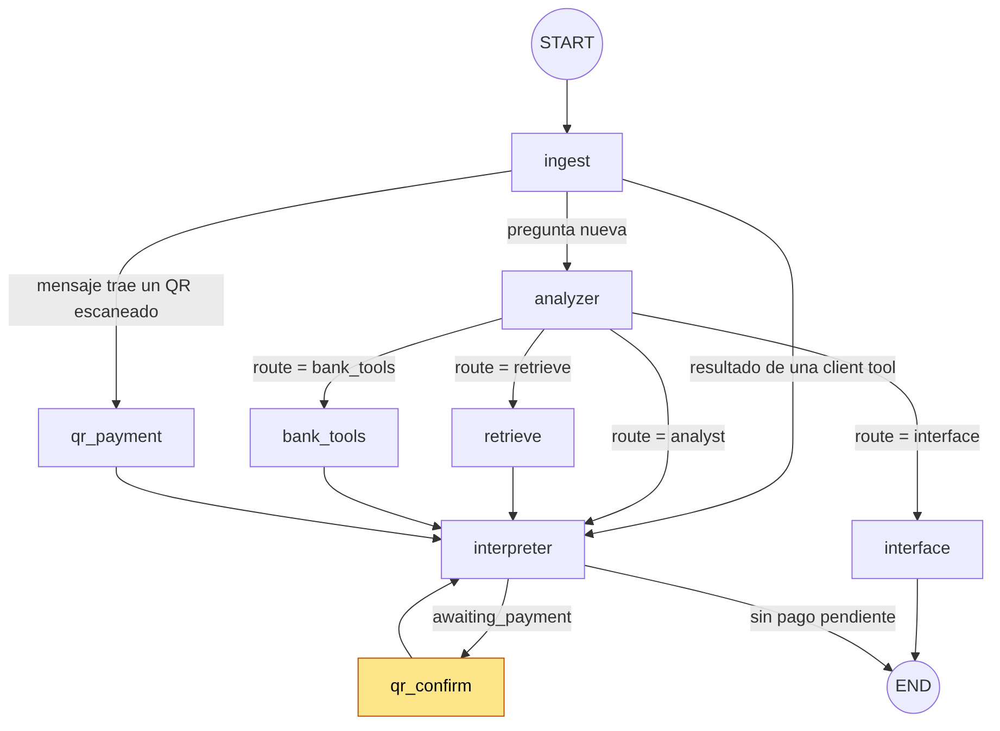
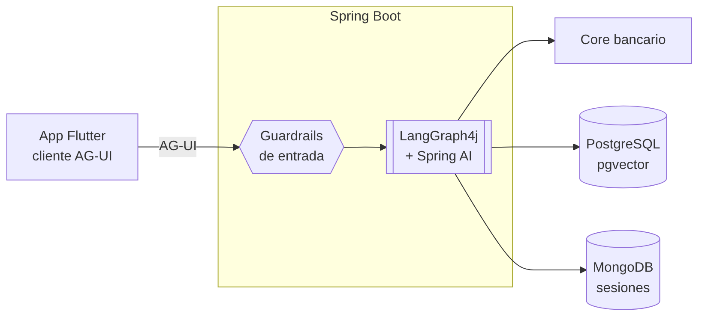

## ¿Qué es?

Una billetera digital donde el cliente conversa con un asistente de IA. Puede preguntar su saldo, resolver dudas sobre tarifas y normativa, y pagar con QR, todo desde el chat.

- **Repositorio:** <https://github.com/RuddyQuispe/bank-assistant-AG-IU>
- **Video de demostración:** _pendiente_ <!-- TODO: link del video -->

## ¿Qué puede hacer?

- **Responder dudas** sobre tarifas y normativa, indicando el documento y la página de donde sacó la respuesta.
- **Mostrar el saldo** de las cuentas.
- **Pagar con QR:** escanea el código y pide confirmación antes de pagar.
- **Personalizar la app:** cambia el fondo, el modo claro u oscuro y el tamaño de letra cuando se lo pides.

## ¿Cómo está hecho?

- **Frontend:** React. Se comunica con el backend por **AG-UI**, un protocolo que envía la respuesta del asistente en tiempo real.
- **Backend:** Python con **LangGraph**, que organiza al asistente como un flujo de pasos.
- **Documentos:** el asistente consulta 6 PDFs públicos (tarifarios y normativa ASFI) para responder.

## ¿Por qué LangGraph?

Porque permite **pausar el flujo y esperar una aprobación** antes de hacer algo delicado. Hoy lo usamos para que el cliente confirme cada pago QR.

Lo mismo sirve, más adelante, para que un supervisor apruebe una transferencia grande, aunque responda horas después: el flujo retoma donde quedó.

## ¿Qué sigue?

| Hoy | Propuesta | Por qué |
|---|---|---|
| Web en React | App móvil en **Flutter** | Una sola app para iOS y Android |
| Backend en Python | **Spring Boot + Spring AI + LangGraph4j** | Se integra mejor con el core del banco, que ya usa Spring |
| Base vectorial Chroma | **PostgreSQL + pgvector** | Usa una base que el equipo ya conoce |
| Sesiones en SQLite | **MongoDB** | Guarda el historial de chat de forma flexible |
| Sin filtro de entrada | **Guardrails** (AWS Bedrock o Google Model Armor) | Bloquea mensajes maliciosos y protege datos personales |

**A tener en cuenta:**

- Para Flutter y Java existen librerías de AG-UI hechas por la comunidad, no oficiales. Conviene probarlas primero; si no alcanzan, el protocolo es simple de implementar.
- LangGraph4j mantiene la pausa para aprobaciones, que es la razón principal para usar LangGraph.

## Referencias

- AG-UI para Dart: <https://pub.dev/packages/ag_ui>
- AG-UI para Java: <https://docs.ag-ui.com/sdk/java/overview>
- LangGraph4j: <https://langgraph4j.github.io/langgraph4j/>
- Spring AI pgvector: <https://docs.spring.io/spring-ai/reference/api/vectordbs/pgvector.html>
- AWS Bedrock Guardrails: <https://docs.aws.amazon.com/bedrock/latest/userguide/guardrails-use-independent-api.html>
